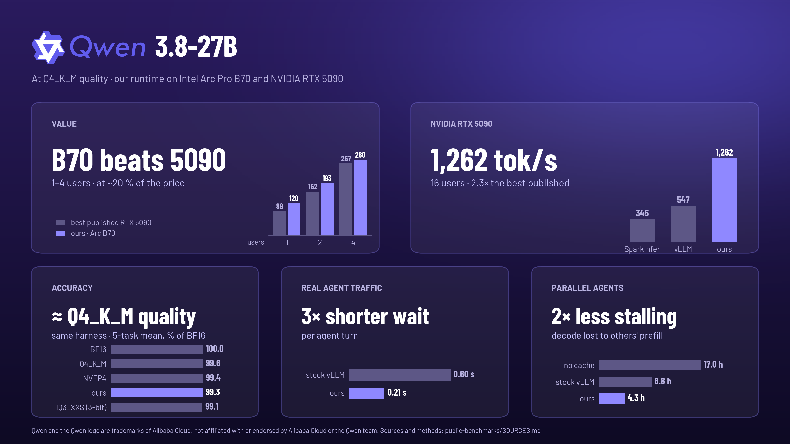
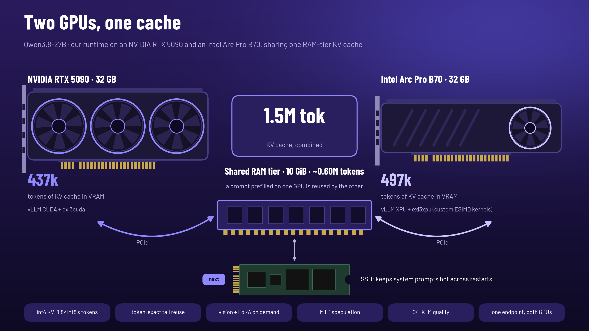
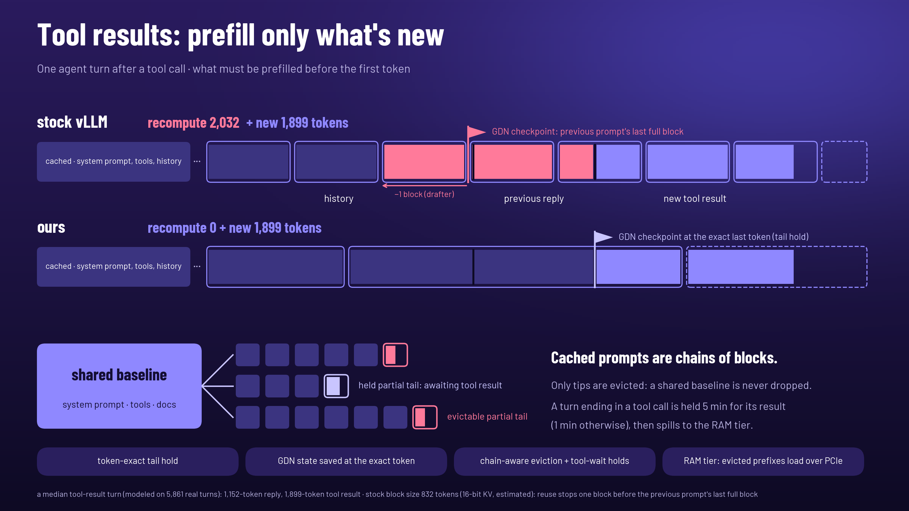
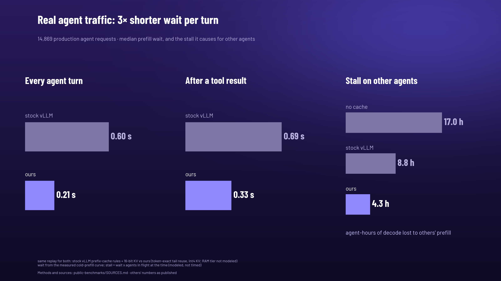
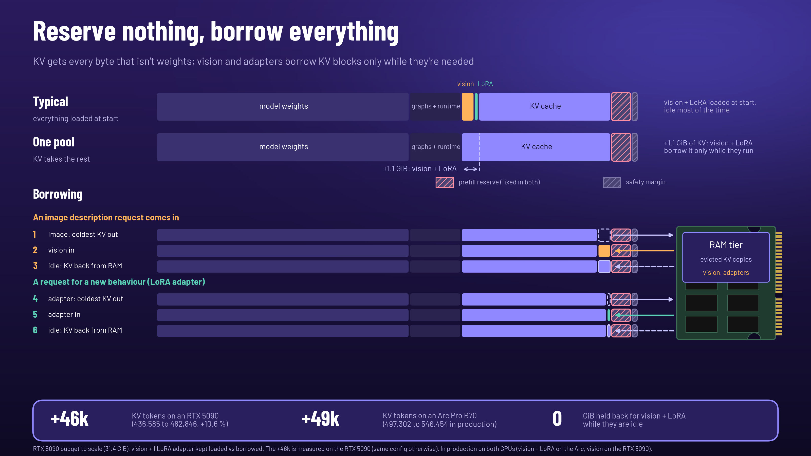

# AllRunner

**The fastest way we know to serve Qwen3.8-27B at or above Q4_K_M quality on one RTX 5090 or one Arc Pro B70.**

AllRunner is the serving stack behind these numbers: vLLM with our kernels and scheduler changes on each GPU, a
shared host-RAM KV tier for both, and the benchmarks that measure it against the fastest published results. Every
external number links to its source; every number of ours comes from public prompts and the scripts in this repo.

## Results

- [benchmarks/README.md](benchmarks/README.md): every comparison, with tables and sources.
- [benchmarks/SOURCES.md](benchmarks/SOURCES.md): where each external number comes from.
- [benchmarks/results/](benchmarks/results/): raw results.
- [benchmarks/harness/](benchmarks/harness/): the scripts that produced them.

## The pieces

One job per repository:

| Repository | Job | What | License |
|---|---|---|---|
| [echowarp/exllamav3](https://github.com/echowarp/exllamav3) | kernels (RTX 5090) | EXL3 kernels and the `exl3cuda` vLLM plugin that registers them | MIT |
| [echowarp/exl3xpu](https://github.com/echowarp/exl3xpu) | kernels (Arc Pro B70) | EXL3 ESIMD kernels and the Arc vLLM plugin | MIT |
| [echowarp/vllm](https://github.com/echowarp/vllm) | engine core | vLLM 0.26 with small feature commits (scheduler, spec decode, packed KV for hybrid models, extension hooks for a memory layer). Branches `main` and `xpu` (Arc: Intel's llm-scaler patch as commit 0). One commit per feature, so each can go upstream on its own | Apache-2.0 |
| [echowarp/AllBroker](https://github.com/echowarp/AllBroker) | memory | the broker (host-RAM KV tier, SSD tier), the weight keeper (weights stay in GPU memory across engine restarts), and one Python package, `llmt_kv`, that plugs into vLLM: RAM-tier KV connector, KV-block lending (LoRA, vision), keeper loader hooks | MIT |
| [echowarp/b70-linux](https://github.com/echowarp/b70-linux) | host (Arc Pro B70) | xe kernel patches (330 W power limit on boards that allow it), fan tools for the idle-fan latch, monitoring without keeping the card awake. Optional: each Arc chart footnote states the power limit it was measured at | GPL-2.0 (patches), MIT |
| AllRunner (this repo) | deployment | router, launchers, Docker builds, benchmarks, charts | MIT |

How they fit at run time: the launchers start the broker (`kvbroker.sh`), optionally the weight keeper, one engine per
GPU (`rtx5090.sh`, `arc-b70.sh`: containers built from `docker/`), and the router (`router.sh`) in front of them. Each
engine is the vllm fork plus its GPU's kernel plugin plus `llmt_kv` (installed as a vLLM plugin: the KV connector is
selected with `--kv-transfer-config`, the rest comes in through `vllm.general_plugins`). Clients talk to the router's
OpenAI-compatible API.

## Install and run

1. Build the image for your GPU: `docker build -f docker/Dockerfile.rtx5090 .` or `docker build -f
   docker/Dockerfile.arc .`. Each Dockerfile clones the component repos at pinned commits (`*_REPO`, `*_REF`,
   `*_COMMIT` build args; override them to build from your own clones).
2. Create the hash-seed file and the site settings: [launchers/README.md](launchers/README.md) ("Before the first
   start").
3. Start the broker, the engines and the router in that order ([launchers/README.md](launchers/README.md), "Start
   order"). Every site value (model directory, ports, broker socket, cache volume, data files) is a variable at the
   top of each launcher.

GPU-specific settings are configuration, not code: memory utilization, torch allocator cap, max sequences, MTP depth
schedule, KV dtype and broker lease share are launcher variables (tables in [launchers/README.md](launchers/README.md));
the router's per-GPU rates (`prefill`, `dec`, `cap`, `prefer_until`, `max_ctx`, `lora`, `priority_sched`) are keys in
[router/router.example.json](router/router.example.json) ([router/README.md](router/README.md)).

Router: [router/README.md](router/README.md) (prefix affinity, cost model, spill, split prefill, prefix hints from the
broker, LoRA adapters by suffix, and an optional session / priority policy driven by request headers and a policy file:
[router/router-policy.example.json](router/router-policy.example.json)).

Tests (CPU only, no GPU, no network beyond 127.0.0.1): `for t in router/tests/test_*.py; do python3 "$t" || echo
"FAILED: $t"; done`.

## What makes it fast

- **EXL3 4.0 bpw weights** with custom kernels on both GPUs: closer to BF16 than Q4_K_M.
- **int4 KV cache** (per token and head): about twice the context of int8 KV in the same VRAM.
- **MTP speculation** (k=7) with draft depth chosen per batch size.
- **Prefill only what's new:** a host-RAM KV tier shared by both GPUs, and a token-exact tail hold that keeps an agent's
  conversation ready while it waits for a tool result.
- **No fixed reserves:** the vision encoder and LoRA adapters borrow KV blocks only while they run.

On production agent traffic (replayed through both cache rules, wait from the measured prefill curve), the median
prefill wait per turn drops from 0.60 s with stock vLLM's prefix cache to 0.21 s:

Borrowing instead of reserving gives the RTX 5090 46k more KV tokens (436,585 to 482,846):

Every chart with its measurement setup: [benchmarks/README.md](benchmarks/README.md).

## License

MIT ([LICENSE](LICENSE)). The Qwen logo is Alibaba Cloud's (Apache-2.0, trademark; see
[benchmarks/charts/assets/NOTICE.md](benchmarks/charts/assets/NOTICE.md)). The component repositories keep their
own licenses (table above).
