# Qwen3.8-27B on one RTX 5090 and one Arc Pro B70: public benchmark comparisons

Our serving runtime for Qwen3.8-27B, measured on public, repeatable benchmarks next to the fastest published results on
the same GPU. Every external number links to its source in [SOURCES.md](SOURCES.md). Every number of ours comes from
public prompts (downloaded by [harness/fetch_data.sh](harness/fetch_data.sh)) and the scripts in [harness/](harness/).
Raw results are in [results/](results/).

**Claim under test:** on each GPU, our runtime is the fastest published implementation of Qwen3.8-27B at or above
Q4_K_M quality.

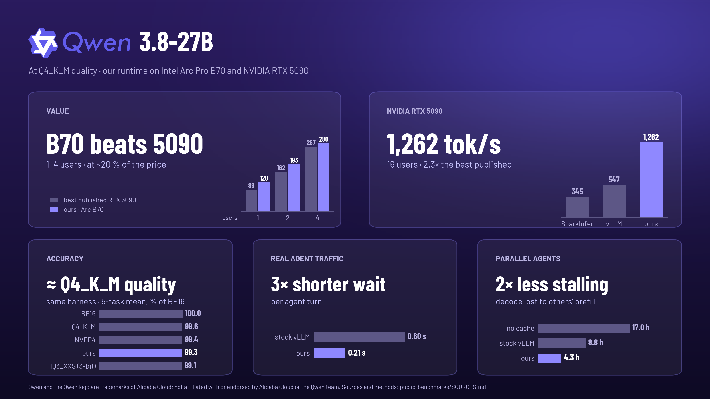

Summary of this page: Arc B70 vs the best published RTX 5090 results at 1-4 users and the RTX 5090 at 16 users
(aggregate harness below), the 5-task mean as % of BF16 (Quality), and the modeled wait and stall on production agent
traffic (Agent traffic).

## What runs

| | RTX 5090 (32 GB) | Arc Pro B70 (32 GB) |
|---|---|---|
| Engine | vLLM (CUDA) + our exl3cuda kernels | vLLM (XPU) + our exl3xpu fork (ESIMD kernels) |
| Weights | EXL3 4.0 bpw: closer to BF16 than Q4_K_M (KL vs BF16 on our 24-chat set: 0.0060 with int8 KV, 0.0080 with int4 KV, vs Q4_K_M 0.0140) | same |
| KV cache | int4 per token and head | same |
| Speculation | MTP k=7, depth by batch size, compact draft vocabulary, per-request draft rows | same |
| Cache | GPU prefix cache + host-RAM KV tier shared by both GPUs + tail hold for agent turns | same |

Both GPUs were measured in their **production configuration** (unchanged launchers, full shared RAM tier). For the
throughput runs the router held the measured engine out of traffic; the client also cancels its own requests whenever a
real request arrives, discards that cell and reruns it, so every reported cell ran without other traffic.

**Data files.** The runs on this page used production's own draft vocabularies and K-smoothing table (built on our
agent traffic; not published). The launchers ship public equivalents (`../data/`). The public K-smoothing table matches
production's on the Arc (NLL +0.037 %); speed with the public draft vocabularies
in [`../data/draft-vocab/`](../data/draft-vocab/) is not measured yet (MTP acceptance, and so decode, can differ).
Launcher defaults vs production, setting by setting: [`../launchers/README.md`](../launchers/README.md#production-parity).

## Arc Pro B70: upstream exl3xpu's own benchmark

The fastest published B70 numbers for this model come from the upstream exl3xpu project, measured with its own panel
(`bench/sweep.py --corpus real`: Gutenberg passage + essay for prose, HumanEval for code; thinking on, T=0.7). We ran
the same script against our production engine: decode = mean of 2 reps (`xpub-curve-20261112`, production engine drained
by the router); prefill = mean of 3 reps on a quiet box (`xquiet-prefill-20261113`: same flags, fresh engine with the
production launcher, no memory pressure).

| Aggregate decode tok/s | Ours, prose | upstream, prose | Ours, code | upstream, code |
|---|---|---|---|---|
| 1 stream | **125.0** | 91.2 | **84.9** | 66.1 |
| 2 streams | **187.2** | 151.4 | **150.1** | 125.3 |
| 4 streams | **311.1** | 262.6 | **271.2** | 212.9 |
| 8 streams | **451.5** | 357 | **420.1** | 322 |
| 16 streams | **530.2** | 365 | **532.7** | 350 |

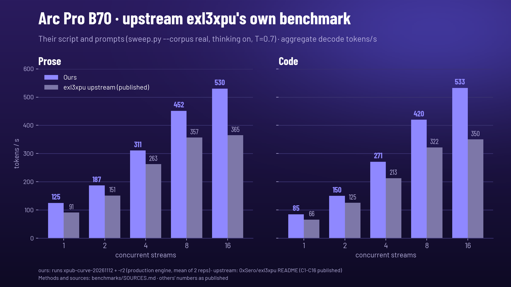

Aggregate decode tok/s at 1-16 streams, prose and code: ours (production engine, mean of 2 reps) vs upstream exl3xpu's
published C1-C16 results, same script and prompts.

| Cold prefill, 1 stream | 2K | 4K | 8K | 32K |
|---|---|---|---|---|
| Ours (tok/s) | **2,722** | | **3,153** | **2,823** |
| upstream (tok/s) | | 2,421 | | 2,124 |

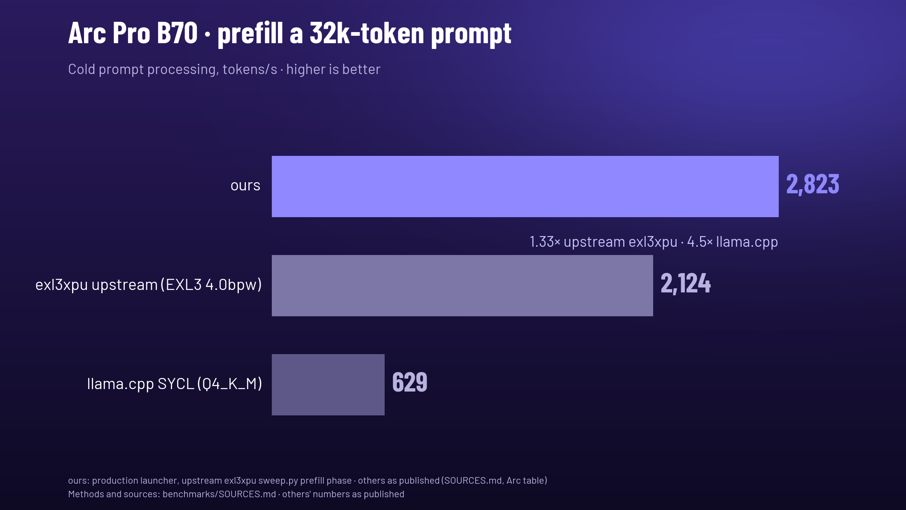

Cold prefill of a 32k-token prompt: ours 2,823 tok/s (upstream's `sweep.py` prefill phase, mean of 3 reps) vs upstream
exl3xpu 2,124 and llama.cpp SYCL Q4_K_M 629 (both as published, [SOURCES.md](SOURCES.md)).

Other published single-B70 results are slower: vLLM XPU GPTQ Int4 + MTP4 84.6 tok/s on a 512 / 128 greedy prompt with
near-100 % acceptance; llama.cpp SYCL Q4_K_M 20-37 tok/s. The fastest multi-card result we found, INT4 AutoRound on
**two** B70s, reports 57 tok/s single stream.

## RTX 5090: replicas of the fastest published harnesses

Run `chart5090-20261116-shipped` (single stream) and `chart5090-20261116-shipped` + `-head` (aggregate, pooled median of 6 reps over two loads), 2026-11-16: RTX 5090 on **shipped defaults** (public draft vocabulary, public K-smoothing table, DYN / Q4 draft head rows, draft graphs; no traffic-derived draft head), held out of traffic by the router; median of 3 reps per cell (aggregate: 6), 0 errors. With workload-tuned tables (our production configuration) every number is within about 1-3 % higher. Harness: [harness/yieldbench.py](harness/yieldbench.py)
(`--suite spark`, `--suite agg`). The older run `g5090-public-20261110` is kept in
[results/rtx5090-replicas-20261110.jsonl](results/rtx5090-replicas-20261110.jsonl).

**Single stream, SparkInfer's cross-engine harness shape:** max 256 tokens, temperature 0, thinking off, sequential.
SparkInfer's prompts are not published, so we used the first items of public sets per workload: chat = first MT-Bench
question of 6 categories, code = HumanEval 0-5, math = GSM8K test 0-5, JSON = json-mode-eval 0-5. Rate = per-request decode tokens/s; median of 3 reps.

| Workload | **Ours** (tokens/step) | SparkInfer + DSpark v2 (accept τ) | SGLang + DSpark | SparkInfer / SGLang, no speculation |
|---|---|---|---|---|
| Chat | **238.7** (3.36) | 174.4 (2.32) | | |
| Code | **458.5** (6.93) | 420.2 (6.78) | | |
| Math | **319.0** (4.83) | 276.5 (4.36) | | |
| JSON | **426.7** (6.42) | 296.4 (4.60) | | |
| Overall | **337.6** (harmonic mean, SparkInfer's definition) | 264.8 | 161.7 | 92.9 / 85.8 |

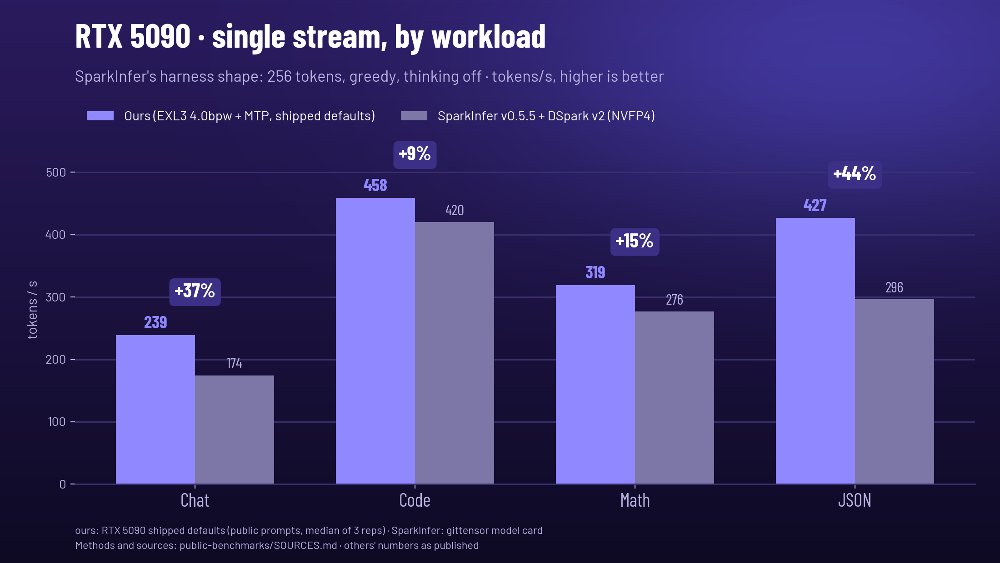

Per-request decode tok/s per workload (256 tokens, greedy, thinking off): ours on shipped defaults, median of 3 reps,
vs SparkInfer + DSpark v2 as published.

**Per second we are faster in every workload type** (chat +37 %, code +9 %, math +15 %, JSON +44 %, overall +27 %).
Where it comes from, since speed = steps per second x tokens per step and SparkInfer publishes its acceptance:

| Workload | Ours: steps/s, tokens/step | SparkInfer + DSpark v2: steps/s, accept τ |
|---|---|---|
| Chat | 71.0, 3.36 | 75.2, 2.32 |
| Code | 66.2, 6.93 | 62.0, 6.78 |
| Math | 66.0, 4.83 | 63.4, 4.36 |
| JSON | 66.5, 6.42 | 64.4, 4.60 |

Per-step engine speed is about even; the MTP drafter accepts more tokens per step. Acceptance is measured on public
prompts of the same workload type (SparkInfer's own prompts are not published).

**Multi-user aggregate, SparkInfer's concurrency test shape:** distinct prompts per request (GSM8K / HumanEval), 128
output tokens each, 32 requests per level, temperature 0, thinking off.

| Concurrent requests | 1 | 2 | 4 | 8 | 16 | 32 |
|---|---|---|---|---|---|---|
| **Ours, RTX 5090, aggregate tok/s** | **293.4** | **485.4** | **650.5** | **869.7** | **1,262.5** | **1,337.6** |
| **Ours, Arc B70, shipped defaults** (Arc Pro B70 at 300 W, public draft vocabulary + K-smoothing table; median of 3 reps) | **119.7** | **193.4** | **280.2** | **390.1** | **479.0** | **477.5** |
| SparkInfer v0.5.5 | 88.9 | 162.1 | 249.6 | 344.3 | 345.1 | 318.2 |
| vLLM 0.28 | | 134.5 | 266.6 | 545.8 | 546.6 | |

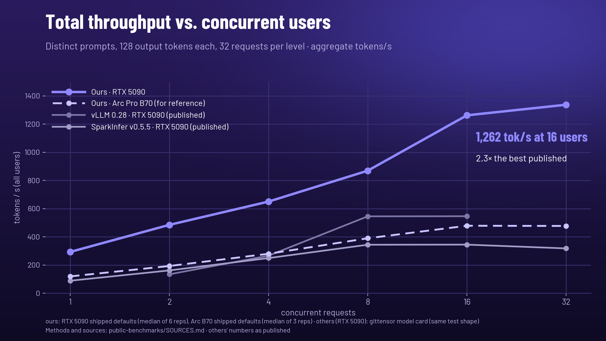

Aggregate tok/s at 1-32 concurrent requests (distinct prompts, 128 output tokens, 32 requests per level): ours on the
RTX 5090 (median of 6 reps) and the Arc B70 (median of 3), both on shipped defaults, vs vLLM 0.28 and SparkInfer v0.5.5
on the RTX 5090 as published.

Arc numbers measured on a desktop host; a slower host CPU lowers small-batch decode.

**Long input, SGLang cookbook envelope:** 8,192 input tokens (Pride and Prejudice, Project Gutenberg #1342, with a
unique first line per request so nothing is cached) and 1,024 output tokens forced, concurrency 1, temperature 0.

| | Decode tok/s | Prefill | Tokens per step |
|---|---|---|---|
| **Ours** | **198-218** (per-request mean, range over 3 reps of 3 requests; `g5090-public-20261112`, not rerun on 11-16) | 8K in ~1.1 s (2026-11-10 run) | 2.9-3.2 |
| SGLang + DFlash2 (NVFP4) | 206.1 (median TPOT 4.92 ms) | not stated | accept length 4.29 |

This one is a draw: novel continuation with forced length speculates poorly (2.9-3.2 tokens per step for us). Their
input text is not stated.

## Quality

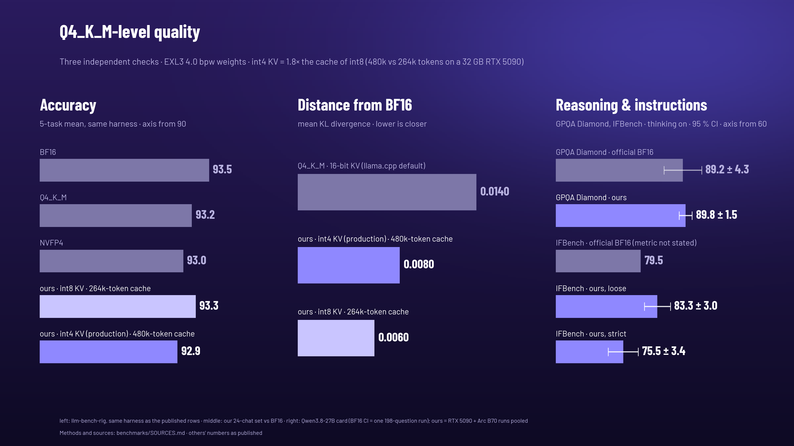

Three checks in one card: the 5-task mean on the published rows' harness (table below), mean KL vs BF16 on our 24-chat
set (Fidelity, below), and GPQA Diamond / IFBench with thinking on vs Qwen's official BF16 scores (ours = the RTX 5090
and Arc B70 runs pooled; 95 % intervals).

Same harness as the published rows ([llm-bench-rig](https://github.com/notwitcheer/llm-bench-rig), thinking off,
greedy, MMLU / HellaSwag 50 % sample with seed 42), run against our RTX 5090 engine with int8 KV and with int4 KV
(production; same engine otherwise):

| | MMLU | ARC-C | HellaSwag | GSM8K | HumanEval | 5-task mean |
|---|---|---|---|---|---|---|
| BF16 | 85.3 | 96.8 | 94.3 | 97.4 | 93.9 | 93.5 |
| Q4_K_M (GGUF) | 85.0 | 96.8 | 94.3 | 97.1 | 92.7 | 93.2 |
| NVFP4 (acyildirimer) | 85.1 | 96.8 | 94.1 | 96.9 | 92.1 | 93.0 |
| **Ours, RTX 5090, int8 KV** | **84.8** | **96.8** | **94.3** | **97.1** | **93.3** | **93.3** |
| **Ours, RTX 5090, int4 KV (production)** | **84.8** | **96.5** | **94.3** | **96.7** | **92.1** | **92.9** |
| UD-IQ3_XXS (3-bit, reference) | 84.3 | 96.3 | 93.8 | 96.8 | 92.1 | 92.7 |

Every 4-bit build sits within about a point of BF16; differences of a few tenths are inside each task's error bar
(about ±0.5-1 point). With int8 KV our 5-task mean is 93.3, level with Q4_K_M (93.2), above NVFP4 (93.0) and 0.2 below BF16;
the int4 KV cache costs another 0.4, mostly HumanEval (2 of 164 problems) and GSM8K (6 of 1,319), the same ordering as
our KL measurements below.

What int4 KV buys: on a 32 GB card at a 196,608-token request limit, the RTX 5090 holds **479,954 tokens** of KV cache
with int4 vs 264,241 with int8 (1.82x); the Arc B70 holds 500,193 (int4) vs 277,333 (int8) and 146,400 (16-bit). That
is 2.4 full-length 196k sessions at once instead of 1.3, or about 16 typical 30k-token agent contexts kept hot in VRAM
instead of 9, before the RAM tier is needed. The price is ~0.4 points on the same-harness board and +0.002 KL.

Our own BF16 run on a second harness (lm-evaluation-harness 0.4.8 `gsm8k_qc`: GSM8K 5-shot, chat, thinking off, T=0,
2048-token cap, full 1,319 questions, strict match; `harness/lmtasks/`): BF16 97.4 ± 0.4, ours on the Arc B70 97.3, ours
on the RTX 5090 96.9. The BF16 number matches the published 97.4, so the two harnesses agree. ARC-Challenge
(`arc_challenge_qc`, 25-shot, chat, thinking off): BF16 96.7 ± 0.5, ours 96.8 (Arc B70) and 96.5 (RTX 5090).

Thinking on, against Qwen's official BF16 scores (model-card sampling): GPQA Diamond 89.9 / 90.4 / 87.4 / 89.9 (mean
89.4 ± 1.4, official 89.2; RTX 5090, 65k cap); IFBench prompt-level loose 83.0 on the Arc B70 and 83.7 on the RTX 5090 (official 79.5, metric not stated by
the card; strict 74.7 / 76.3; all 300 answers finished, no loops). AIME 2025 at the 32k budget of the published RTX 5090 NVFP4 runs: 73.3 / 80.0 / 73.3 / 76.7 (mean 75.8;
published 76.7 for three NVFP4 builds). GPQA Diamond at the same 32k budget: 80.3 / 80.3 / 81.8 / 83.3 / 82.3 (mean 81.6, 5 runs, 8 concurrent;
24-28 of 198 answers hit the cap) vs published gittensor NVFP4 76.3, NVIDIA NVFP4 76.8, QUASAR NVFP4 78.8 (gittensor
card; its prompt template and repeat count are not stated; a single 198-question run carries about ±2.8 points of
sampling error, ours ±1.2 over 5 runs, so our lead over the best NVFP4 build (81.6 vs 78.8) is about 2 standard errors). At this budget the cap, not the weights, decides most of the
gap to the 89 we score uncapped.

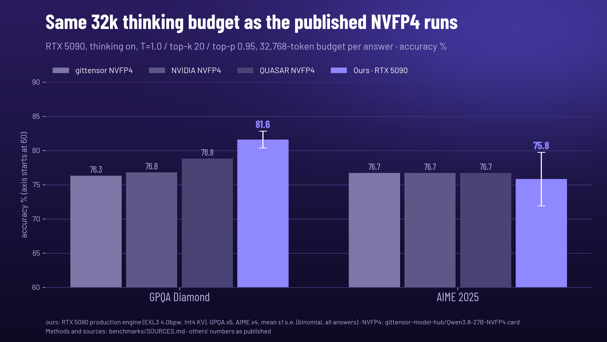

GPQA Diamond (5 runs) and AIME 2025 (4 runs) on the RTX 5090 production engine (int4 KV) at a 32,768-token budget,
mean ± 1 s.e., vs the three NVFP4 builds on the gittensor card. On AIME we are 0.9 below them, inside our error bar.

 Uncapped on the Arc B70 (no token limit, no answer cut off): AIME 2025 96.7 / 96.7 / 96.7 / 93.3 (mean 95.8;
no official BF16 AIME 2025 figure to compare with, so this is reported, not claimed), GPQA Diamond 90.4 / 91.9 / 88.4 / 90.4 (mean 90.3 ± 1.5, official 89.2).

## Fidelity: distance from BF16

Accuracy benchmarks cannot separate good 4-bit quantizations (their error bars are larger than the differences). KL
divergence from BF16 can. On our own set of 24 production-shaped agent chats (10,246 positions, teacher-forced, full
distribution; the chats are customer traffic, so the set is not published, but every row below uses the same
positions and the same BF16 reference):

| vs BF16 | Mean KL | Top-1 agreement |
|---|---|---|
| **Ours, int8 KV** | **0.0060** | **97.8 %** |
| **Ours, int4 KV (production)** | **0.0080** | – |
| Q4_K_M (llama.cpp) | 0.0140 | 97.1 % |

Published NVFP4 builds on public text (adrienbrault/qwen3.8-27b-rtx5090, docs/FIDELITY.md; a different text set and a
truncated top-k KL, so not directly comparable with our table): RedHatAI NVFP4 + FP8 KV 0.0129 (top-1 93.1 %), + NVFP4 KV
0.0141 (92.8 %), NVIDIA NVFP4 0.0226 (90.7 %), gittensor NVFP4 (the checkpoint behind the fastest published RTX 5090
speed numbers) 0.0349 (88.6 %).

## Agent traffic: replays of production

Production agent traffic (customer data: only these totals are published) replayed through each engine's cache rules,
with prefill time from the measured cold-prefill curve. Modeled, not timed.

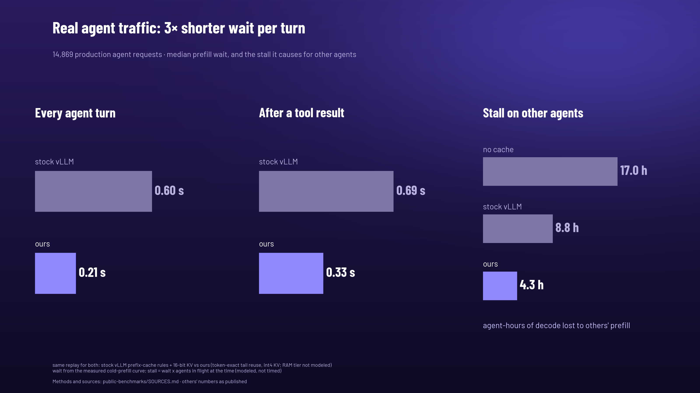

14,869 agent requests (nearly all served by the RTX 5090), same replay for both sides: stock vLLM prefix-cache rules with 16-bit KV vs ours
(token-exact tail hold, int4 KV; RAM tier not modeled). Median prefill wait per turn 0.60 s vs 0.21 s, after a tool
result 0.69 s vs 0.33 s; decode time other agents lose to these prefills 8.8 vs 4.3 agent-hours (no cache: 17.0).

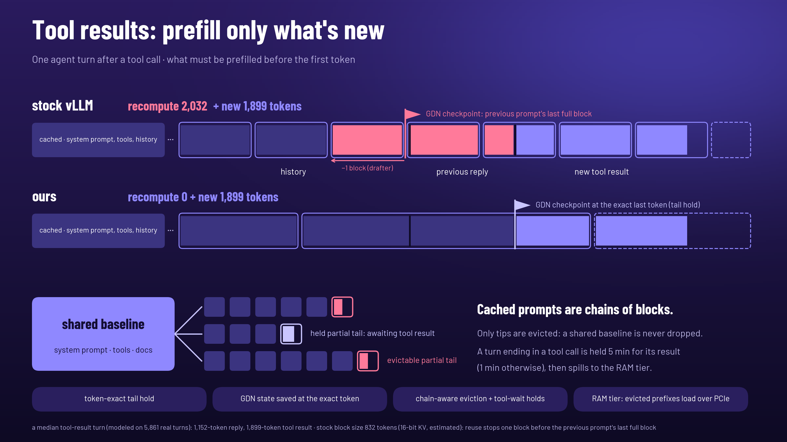

Why the tool-result turn is cheaper: the median modeled turn (5,861 real tool turns) recomputes 2,032 tokens under stock
vLLM's block-rounded cache and none with the tail hold, before the 1,899 new tokens.

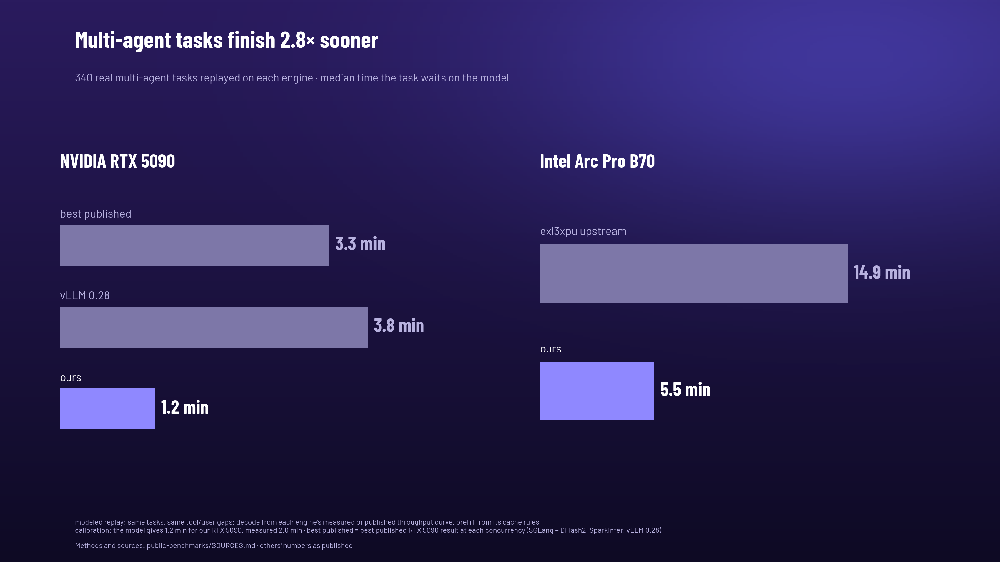

340 multi-agent tasks replayed on each engine with their real tool and user gaps: median time a task waits on the model,
decode from each engine's measured or published throughput curve, prefill from its cache rules. The model is
optimistic: it gives 1.2 min for our RTX 5090 where the trace measured 2.0 min, so read the bars as a comparison, not
as wall-clock times.

## Memory

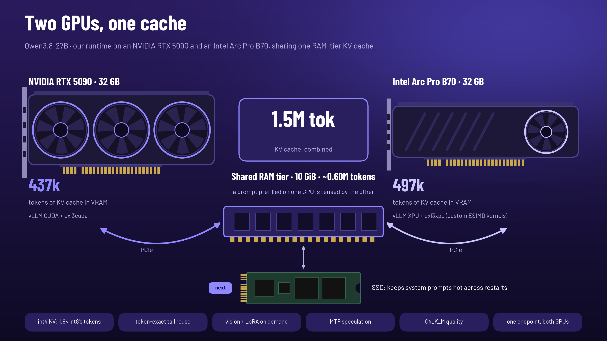

KV capacity of the production engines (RTX 5090 436,585 and Arc B70 497,302 int4 tokens) plus the shared 10 GiB host-RAM
tier (~0.60M tokens, an upper bound since GDN state shares its slots): about 1.5M tokens combined.

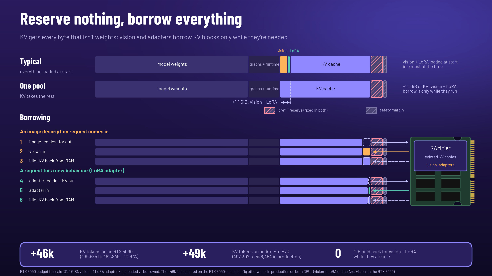

Vision encoder and LoRA adapters borrow the coldest KV blocks only while they run, instead of a fixed reserve: +46k KV
tokens measured on the RTX 5090 (436,585 to 482,846), +49k on the Arc B70 in production. RTX 5090 memory budget to
scale.

## Not yet covered

- Our quality on the public suite above (running).
- Heavy agentic traffic (long growing contexts, tool turns, prefill interruptions, cache tails): no published
  speed numbers to compare against yet.
- Long context (published: SparkInfer 90.3 tok/s at 244K on the 5090).

## Reproduce

```
harness/fetch_data.sh data/                     # public prompt sets + SHA256SUMS
python3 harness/yieldbench.py --base http://<5090-engine>:8001 --data data --suite all --reps 2 --label <L> --out results.jsonl
harness/arc-exl3xpu-panel.sh                    # upstream sweep.py against the Arc engine (needs the exl3xpu repo)
```
